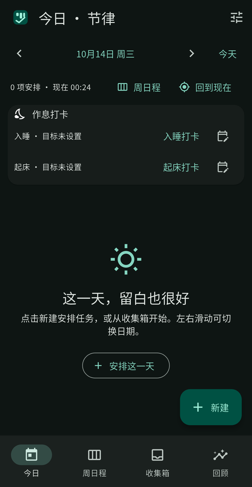
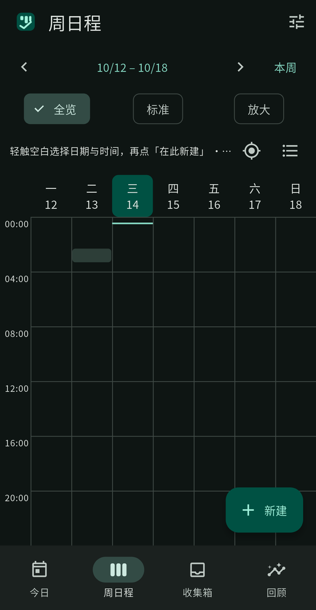
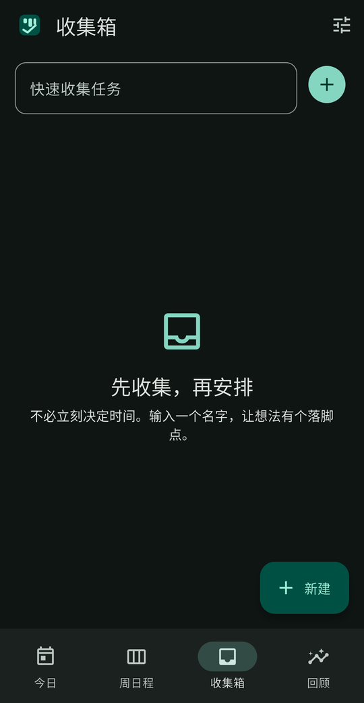
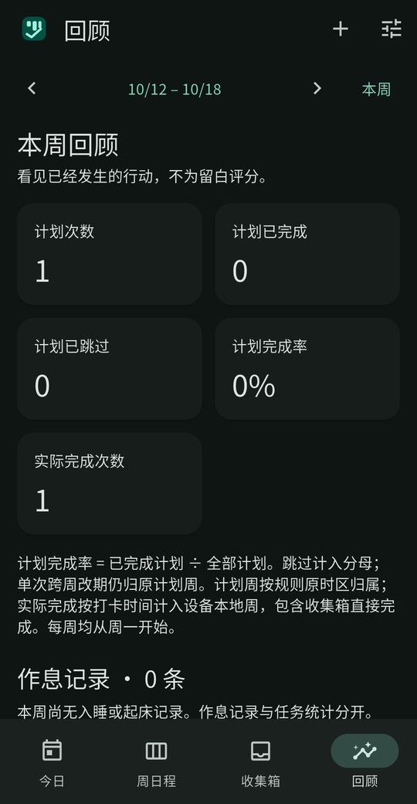

<p align="center">
  
</p>

<h1 align="center">Rhythm · 节律</h1>

<p align="center">先收集，再安排；记录行动，也给生活留白。</p>

<p align="center">
  <strong>Android 优先 · 离线使用 · 无需账号 · 免费开源</strong>
</p>

<p align="center">
  <a href="#界面预览">界面预览</a> ·
  <a href="#主要功能">主要功能</a> ·
  <a href="#开始使用">开始使用</a> ·
  <a href="#本地构建">本地构建</a>
</p>

节律是一款面向个人的日程与执行记录应用。把待办放进收集箱，在今日时间轴和一周日程里安排时间，再通过打卡与周回顾看见实际发生的行动。

核心功能在设备本地运行，不需要账号或服务器。应用使用 Flutter 构建，当前版本为 **0.2.0**。

## 界面预览

<table>
  <tr>
    <th>今日</th>
    <th>周日程</th>
    <th>收集箱</th>
    <th>回顾</th>
  </tr>
  <tr>
    <td></td>
    <td></td>
    <td></td>
    <td></td>
  </tr>
</table>

以上为当前版本在 Redmi Note 5 Pro（Android 17）上的 ADB 实机截图，仅裁去系统状态栏并等比缩小；不是 Web 截图或设计稿。应用随系统切换浅色与深色主题。

图标使用[原始参考图形的 SVG 源](app/assets/icons/rhythm.svg)：三块时间块顶部对齐，中间最高，右侧较窄，配以下方的完成勾号。应用内只随主题调整配色；Android 自适应图标与 Web maskable 图标仅延展背景以适配系统遮罩，不改变标志几何。

## 主要功能

- **今日时间轴** — 按时间查看安排，完成、跳过、撤销或改期；跨午夜任务分段显示，但仍属于同一次执行。
- **七列周日程** — 一屏查看整周，支持全览、标准、放大三档视图；可折叠睡眠时段，也可展开完整 24 小时。轻点空白时段即可开始安排。
- **收集箱** — 只输入名称就能记下任务，之后再安排时间，也可以直接完成未排期任务。
- **重复计划** — 支持重复规则，以及「仅本次」「本次及以后」「整个系列」三种编辑和删除范围。
- **执行历史与周回顾** — 区分计划完成与实际完成，保留完成、跳过时的记录；后续修改或删除计划不会改写已有历史。
- **独立作息记录** — 设置入睡、起床目标，记录、更正或撤销打卡；作息记录不混入普通任务的完成率。
- **本地提醒与备份** — Android 本地通知提醒；JSON 导出与完整替换恢复，不依赖云端服务。

## 开始使用

1. **先收集**：在收集箱记下任务，不必立即决定日期和时间。
2. **再安排**：为任务设置时间、分类、重复规则和提醒，或从今日、周日程直接新建。
3. **记录行动**：完成后打卡；计划改变时可改期或跳过，误操作可以撤销。
4. **回看一周**：在回顾中查看计划完成率、实际完成次数与独立作息记录。

### 提醒需要授权

Android 通知权限和精确闹钟权限分别授权。未授予通知权限时，规划、打卡和数据保存仍可使用；未授予精确闹钟权限时，提醒会降级为可能延迟的非精确调度。

应用维护未来 30 天的滚动提醒窗口，并在启动、恢复前台和每日后台作业中刷新。**强行停止应用、系统后台限制和厂商省电策略都可能影响送达，不能保证所有设备上始终准点。**

### 数据保存在本地，请定期导出

- Android 使用 **SQLite** 保存任务、规则、执行历史和作息数据，不用偏好设置存储任务或历史。
- 设置页可导出 JSON 备份。导入前校验数据，并要求确认；**恢复是完整替换，不是合并**，请先导出当前数据。
- 备份包含计划与记录，但不包含 Android 系统权限；换设备后需要重新授权提醒。
- 不提供账号、云同步或多人协作。设备内的数据不能替代外部备份。

### 周回顾如何计算

计划按规则原时区的原计划周归属；改期或跨周完成不会迁移该计划的归属。跳过仍计入完成率分母，无计划时不显示百分比。

实际完成按设备本地的执行时间归周，包含收集箱直接完成的任务。既有规则保留创建时的计划时区，不会因设备时区变化重新解释；日历按设备本地时间显示。

## 本地构建

Flutter 工程位于 [`app/`](app/)。以下命令从仓库根目录开始执行。

### 环境

已验证的工具链：**Flutter 3.47.7 stable · Dart 3.13.5 · OpenJDK 21 · Android SDK 36**。Dart SDK 约束为 `^3.13.5`，依赖版本由 `app/pubspec.lock` 固定。

先安装 [Flutter SDK](https://docs.flutter.dev/get-started/install) 和 [Android command-line tools](https://developer.android.com/studio#command-tools)，并运行 `flutter doctor` 检查环境。

### 在 Android 上运行

```sh
cd app
flutter pub get
flutter devices
# 将 DEVICE_ID 替换为 flutter devices 列出的 Android 设备 ID
flutter run -d DEVICE_ID
```

### 构建 APK

在 `app/` 下执行：

```sh
flutter build apk --release --split-per-abi
```

产物位于 `app/build/app/outputs/flutter-apk/`（相对仓库根目录），分别包含 `armeabi-v7a`、`arm64-v8a` 和 `x86_64` APK；按设备架构选择安装。

> 当前 release 构建仍使用 **debug 签名**，用于侧载验证，不是正式发布签名。正式分发前需配置自己的签名密钥。首次构建需要网络，安装后的核心功能不需要网络或账号。

若容器中仅因引擎解压无法修改属主而失败，可为该次构建添加 `env TAR_OPTIONS=--no-same-owner`；普通环境无需设置。当前 `workmanager_android` 存在未来 Flutter 内置 Kotlin 支持的迁移警告，升级工具链或插件后需重新验证。

### 检查代码

在 `app/` 下执行：

```sh
flutter analyze
flutter test
```

测试覆盖重复规则、时区与夏令时、编辑范围、历史与统计、备份校验、失败写入、作息记录、日程交互及实际 SQLite 文件持久化。

<details>
<summary>可选：通过浏览器预览</summary>

在 `app/` 下执行：

```sh
flutter build web --target lib/main.dart --no-web-resources-cdn --no-wasm-dry-run
python3 -m http.server 18080 --directory build/web
```

打开 <http://127.0.0.1:18080/>。Web 是界面预览入口，不支持 Android 本地提醒；数据保存在浏览器中，清除站点数据会删除它。当前不提供离线冷启动的 Web PWA，不能用 Web 预览替代 Android 原生能力验证。

</details>

## 项目结构

```text
app/
├── lib/
│   ├── core/          # 模型、重复规则、Planner、存储与提醒
│   ├── features/      # 今日、周日程、收集箱、回顾、编辑与设置
│   └── main.dart      # 启动与主题
├── test/              # 业务、界面交互与 SQLite 测试
├── android/           # Android 平台配置
├── web/               # Web 预览入口
└── assets/            # 应用图标与中文字体
assets/readme/         # README 专用真机截图
```

业务数据统一由 `Planner` 管理：变更串行写入，持久化成功后才更新界面；写入失败保留原状态。日程按查询窗口计算，不预生成多年实例，提醒与界面使用同一套计划数据。

## 开源许可

应用代码采用 [MIT License](LICENSE)。中文字体来自 [Noto CJK](https://github.com/notofonts/noto-cjk)，采用独立的 [SIL Open Font License](app/assets/fonts/OFL.txt)。第三方依赖许可也可在应用设置中查看。
