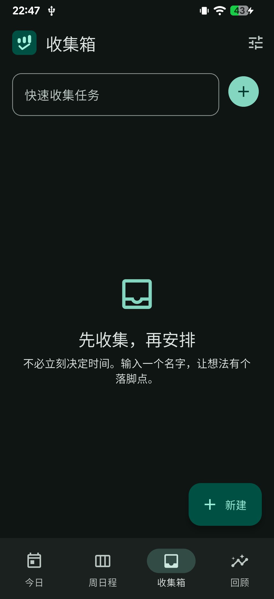
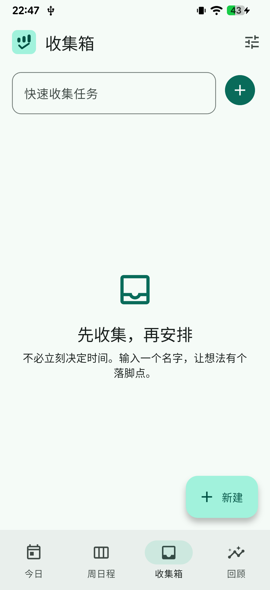
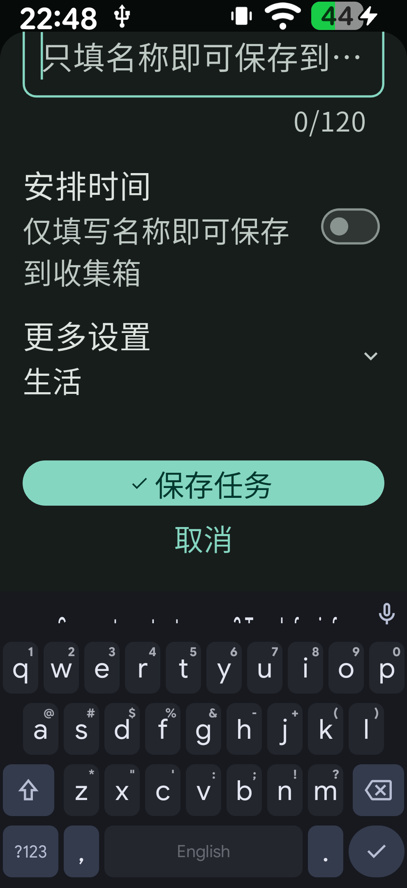
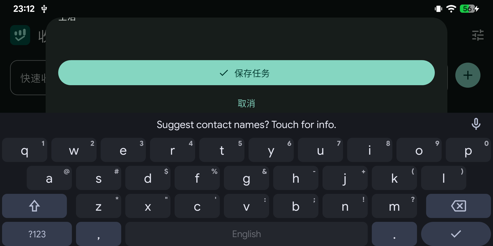

# 第二阶段验证记录

历史第二阶段受测版本：`0.2.0+2`（Android `versionCode 2002`）；日期：2026-10-12。下方保留当时的独立作息证据，不表示当前源码仍提供独立作息功能。
环境：Linux x64、Flutter 3.47.7 stable、Dart 3.13.5、OpenJDK 21、Android SDK 36。

## 任务流程与作息统一复验 — 2026-10-13

本轮受测为当前未发布源码，工程版本号仍为 `0.2.0+2`；以下证据独立于后面的历史第二阶段记录。

- **自动化：** `flutter test` 58 项全部通过，覆盖 v1 / v2 到 v3、归档与任务快照保留、旧格式严格校验、普通睡觉 / 起床每日任务状态转换、取消排期不写入、排期保留身份和跨时区预设。SQLite FFI 使用实际临时数据库验证升级、重开、完整替换与事务拒绝后不发布、后续可提交。
- **分析：** `flutter analyze` 仅报告既有 `test/audit_smoke_test.dart` 三处 `avoid_print` 信息，命令因此退出 1；不能写成全项目无问题。该既有审计测试打印了极端日期规则查询的 `RangeError`，本轮没有修改它。
- **构建：** Web 构建与 armeabi-v7a / arm64-v8a / x86_64 release APK 均成功；仍为 debug 签名，仍有 `workmanager_android` Kotlin 迁移警告。构建还打印 Gradle `Already watching path`，最终三包均成功生成。
- **隔离升级：** 独立 Chromium origin `http://127.0.0.1:18138/`，旧 Web 创建一项收集箱任务，并注入合成 v2 作息快照（目标 23:00、Asia/Tokyo、记录 `2026-10-05T14:15:00.000Z`）和 23:00–07:00 折叠偏好。刷新新版后首页无独立作息卡；设置显示只读归档，目标日期 / 时间 / 时区 / 实际记录时刻可查看，无更正或撤销操作。
- **持久化：** 修改折叠偏好后浏览器文档写为 schema v3，原任务 ID、标题和旧作息快照保持不变；没有自动创建睡觉 / 起床任务。取消原收集箱任务的排期后文档完全不变；再次保存排期后任务与规则使用同一任务 ID。
- **实际任务闭环：** 该项完成后回顾实际显示计划 1、完成 1、完成率 100%、实际完成 1，没有独立作息统计。通过全局「安排日程」手动创建「睡觉」，选择每天重复和提前 10 分钟提醒；文档中为普通 `Task` / `ScheduleRule`。睡觉任务完成、撤销、主动跳过均实际操作；撤销两项完成后、跳过睡觉本次，回顾显示计划 7、完成 0、跳过 1、实际完成 0，旧作息归档仍不变。
- **布局与重新加载：** 390×844 今日 / 设置 / 编辑器 / 回顾实际观察；重新加载后任务、跳过状态、显示边界和归档保留。360×640 周日程保持七列并显式折叠 00:00–07:00 / 23:00–24:00，任务仍可访问；页面滚动尺寸为 360×640。两倍字号由现有 widget 回归覆盖，不冒充本轮真机字号证据。
- **边界：** 本轮没有安装 APK、变更 Android 用户数据、测试原生通知送达或 SAF。提醒提前量已在任务中保存，但 Web 不支持 Android 本地通知；APK 构建和 SQLite FFI 不证明 Android 插件送达或平台通道。浏览器数据均为专用 origin 的临时样本，结束后清理。

## 构建与自动化

- `flutter analyze`：无问题。
- `flutter test`：60 项全部通过，含品牌主题、七列日程交互、全局 UI、作息记录、旧版快照迁移及 SQLite 持久化回归。
- `dart tool/export_icons.dart`：生成 Android 五种密度图、Web favicon、普通及 maskable 图标；重复导出后十个 PNG 的 SHA-256 均与首次一致。Web maskable 安全区及多种自适应遮罩预览另有静态检查。通知专用 `ic_notification` 与 `raw/keep.xml` 保留。
- `flutter build apk --release --split-per-abi`：armeabi-v7a、arm64-v8a、x86_64 均成功。
- `flutter build web --target lib/main.dart --no-web-resources-cdn --no-wasm-dry-run`：成功，使用本地 Flutter Web 资源。
- Release APK 仍使用 debug 签名，仅供侧载验证。构建仍提示 `workmanager_android` 的 Kotlin Gradle Plugin 迁移警告；本次构建成功，升级时须重验。

## Web 实际操作

主要流程使用独立 Chromium 页面 `http://127.0.0.1:18180/`，视口为 390×844 CSS px（设备像素比 1.25）及 360×640 CSS px；本轮最终修复复核使用独立页面 `http://127.0.0.1:18181/`。结束时仅清除这些隔离 origin 的合成 `localStorage` / `sessionStorage` 数据，未访问或清理其他 origin。Web 插件能力不代表 Android 插件能力。

- 在收集箱仅输入名称创建一项临时验证任务；安排到 2026-10-12 21:11–22:11 后，收集箱不再重复显示；今日及周日程各显示同一项。直接完成没有打开详情，卡片留在原时段并显示已完成；轻量反馈可撤销。回顾显示计划 1、完成 1、完成率 100%、实际完成 1；撤销后回到计划 1、完成 0、实际完成 0。周日程“本周全部日程”可打开该项并进入完整详情；在详情中主动跳过后，同一原时段显示已跳过，回顾显示计划 1、跳过 1、完成率 0%、实际完成 0。
- 实际创建每周一 / 周三重复任务，将周一实例单次推迟至周二 21:38；周三实例仍留在原时段。对周三实例执行「仅本次」改名后，周二改期实例未变；执行「本次及以后」改名后，周三与下一周实例均更新。依次验证三种删除范围：单次删除仅移除所选周一实例；从周三起删除后续范围会清除下周实例；整个系列改名后再删除整个系列，剩余周内实例消失。Planner 行为测试覆盖系列版本与已有执行历史保留契约。
- 周日程实际切换「全览 / 标准 / 放大」。在设置中保存 23:00 / 07:00 作息并启用折叠后，每天 00:00–07:00 与 23:00–24:00 明确显示为折叠区间，七列同轴；展开其中一段会同步展开七天。「完整24小时」和恢复折叠均可操作，浏览不改任务时间。360×640 下仍显示七列，`document.documentElement` 的滚动尺寸为 360×640，没有页面级横向或纵向溢出。
- 独立记录入睡 21:15（目标 23:00），再更正为 21:00（提前 120 分钟）并单独撤销；随后记录起床，默认目标日期为 2026-10-13、07:00，实际记录为 2026-10-12 21:16（提前 583 分钟）。回顾显示作息记录 1 条，同时计划仍为 1、完成为 0；撤销作息记录后作息数归零，任务指标不变。重新加载页面后任务及 23:00 / 07:00 / 折叠偏好仍在。
- Web 设置实际导出 schema v2 JSON（1 项日程、作息偏好），先取消恢复，再增加一项收集箱任务并确认完整替换；导入后新增任务消失，原日程与作息偏好恢复。此为 Web 文件选择 / 下载流程，不代替 Android 原生 SQLite 与文件选择器验收。
- 浅色今日、周日程、收集箱、回顾、设置及编辑面板；运行中切换浏览器 `prefers-color-scheme` 后检查深色今日、周日程、收集箱、回顾、设置及编辑面板。使用 Flutter Web 语义树检查并操作中文名称、选中态、空白日程、任务、作息、撤销和导航控件；这是 Web 语义验证，不等同于 Android TalkBack。
- 回顾页新建任务入口仅显示在标题栏，悬浮新建按钮隐藏；390×844 实际作息记录卡片不再被操作按钮遮挡，点击标题栏入口可打开任务编辑器。已更新作息记录与完成回顾截图。
- `BrandMark` 在两种种子色及浅 / 深色的像素级 widget 回归通过；Web 明暗主题变化无需重启，应用内品牌标识与功能图标随主题更新。
- 浏览器中的任务与作息数据均为隔离 origin 的临时验证数据，不是用户数据，也未写入 Android 设备。

截图保存在本目录：浅色今日、折叠周日程、360×640 周日程、深色今日、独立作息与任务指标、完成后的周回顾及跳过状态的今日时间轴。

## Android 17 真机复验 — 2026-10-13

首次尝试时设备停在锁屏，未输入凭据或绕过锁屏；随后设备处于已解锁桌面，无线 ADB 重连后继续验收。受测为 `org.rhythm.rhythm` `0.2.0+2`（versionCode 2002，arm64 release）；Redmi Note 5 Pro，Android 17 / API 37，物理屏幕 1080×2160 px、440 dpi（393×785 dp）。未卸载、清除应用数据或重启设备。

- **主题与页面：** 系统原始深色模式为开启；在应用仍运行时切到浅色，再恢复深色。今日、周日程、收集箱、回顾、设置均实际观察；Today / Week / Inbox / Review 的主界面在浅 / 深色下可见，分类色块、中文标签和导航选中态随当前主题显示。
- **视口与键盘：** 默认视口 393×785 dp；临时将显示尺寸设为 990×2160 px（360×785 dp）后，空收集箱和编辑器可滚动使用。系统字体从 1.0 临时放大至 2.0；Android 真实键盘显示时，编辑器滚动后「保存任务 / 取消」均可达。此前横屏检查为 785×393 dp，真实键盘下也可滚动到保存 / 取消。测试后恢复原生分辨率、字体 1.0、纵向方向及原始深色模式。
- **日期与重启：** 强制停止后重新启动，默认进入今日并显示当前时间；原有待执行日程仍在，回顾值仍为计划 1、完成 0、跳过 0、完成率 0%、实际完成 1。今日切至 10/12、进入周日程再返回，仍保留 10/12；显式「今天」恢复 10/13。
- **原生备份：** 通过 Android DocumentsUI 导出完整 JSON；先取消恢复，再选择刚导出的同一文件并确认完整替换，系统提示恢复成功。恢复前后原有日程与回顾值一致。只删除本轮创建的测试备份；Downloads 中原本没有其他文件。
- **提醒错误隔离：** 临时撤销 `POST_NOTIFICATIONS` 后，创建带「开始时」提醒的测试日程仍保存成功并出现在今日；设置页显示「通知未授权，无法提醒；规划、打卡和历史保存不受影响」。删除该测试日程后重新授予权限；`dumpsys package` 显示通知权限已授予，精确闹钟 app-op 为 `allow`，重启应用后设置页显示未来 30 天 0 条提醒。
- **真实通知：** 在当前 `0.2.0+2` 上创建独立测试提醒，应用退到桌面后，通知栏实际显示 Rhythm 图标、测试标题及 `10/13 22:35 · 生活`。检查时通知仍可见；随后只清除该测试提醒并删除该临时日程，确认原有日程与回顾值恢复。截图仅保留该通知卡片，不包含通知栏中的无线网络名称。

- **界面截图：** 包含 360 dp 空收集箱与竖屏空白编辑器；横屏编辑器截图记录 785×393 dp 下真实键盘开启时「保存任务 / 取消」均可滚动到达。**通知截图：** 仅裁剪本轮专用测试提醒卡片；其临时任务及通知均已清除。

**尚未覆盖：** 启动器当前显示 Rhythm 彩色图标，但 LawnIcons 主题图标设置提示应用修改需重启后才能生效；未切换该设置或重启，故 Android 单色主题图标着色 / 关闭后回退与不同遮罩仍未真机验收。系统未安装 TalkBack，本轮未安装。设备只验证当前系统主题种子的实时明暗切换；另一个种子色由 `brand_mark_test.dart` 覆盖，未在设备逐个验证功能图标。错误弹窗全覆盖及 WCAG 对比度数值未测；日期跨导航、首次当前时间定位已观察，但筛选 / 滚动保留及打卡、分钟刷新、恢复前台时不重定位尚未完整实测。通知权限、字号、分辨率、方向和主题均已恢复；没有修改无线 / 飞行模式。

## Web 截图

