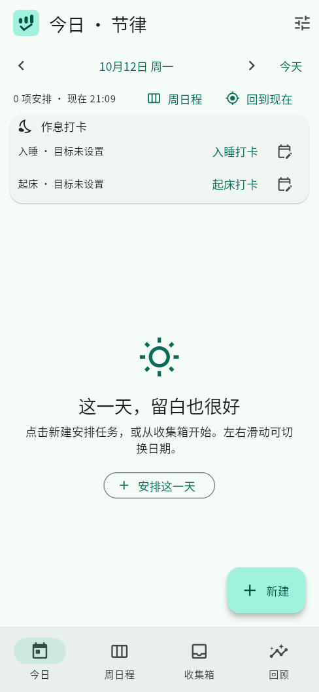
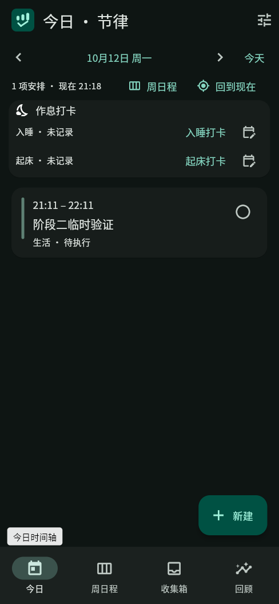
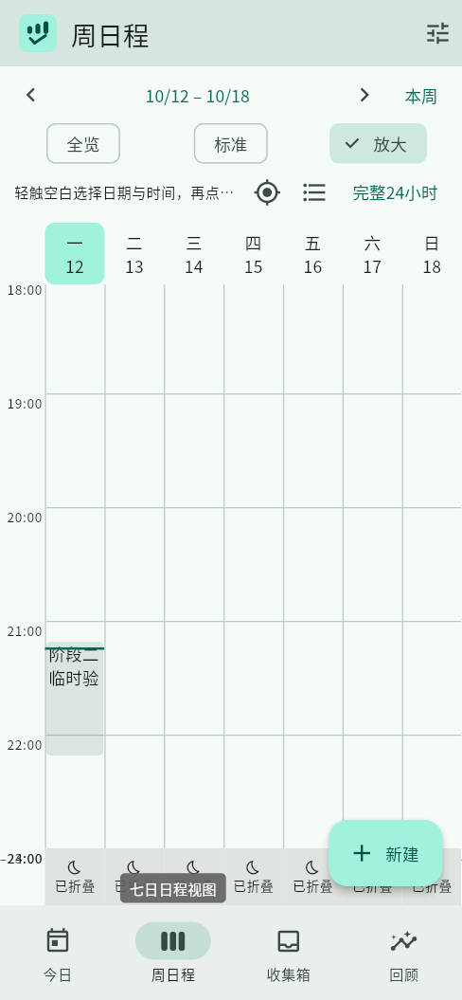
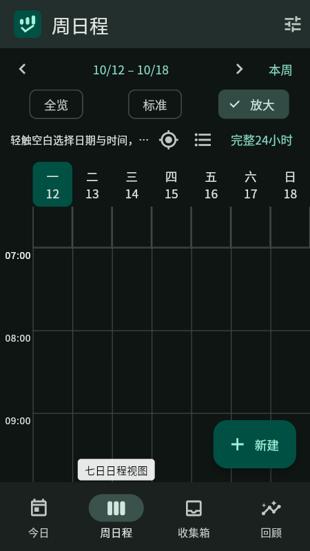
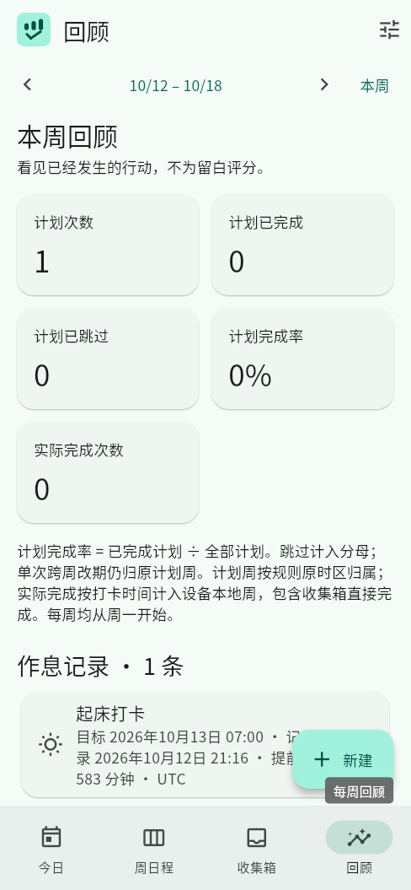
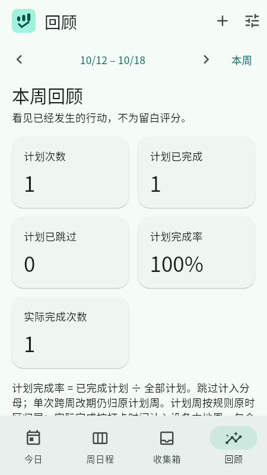

# 第二阶段验证记录

受测版本：`0.2.0+2`（Android `versionCode 2002`）；日期：2026-10-12
环境：Linux x64、Flutter 3.47.7 stable、Dart 3.13.5、OpenJDK 21、Android SDK 36。

## 构建与自动化

- `flutter analyze`：无问题。
- `flutter test`：60 项全部通过，含品牌主题、七列日程交互、全局 UI、作息记录、旧版快照迁移及 SQLite 持久化回归。
- `dart tool/export_icons.dart`：生成 Android 五种密度图、Web favicon、普通及 maskable 图标；重复导出后十个 PNG 的 SHA-256 均与首次一致。Web maskable 安全区及多种自适应遮罩预览另有静态检查。通知专用 `ic_notification` 与 `raw/keep.xml` 保留。
- `flutter build apk --release --split-per-abi`：armeabi-v7a、arm64-v8a、x86_64 均成功。
- `flutter build web --target lib/main.dart --no-web-resources-cdn --no-wasm-dry-run`：成功，使用本地 Flutter Web 资源。
- Release APK 仍使用 debug 签名，仅供侧载验证。构建仍提示 `workmanager_android` 的 Kotlin Gradle Plugin 迁移警告；本次构建成功，升级时须重验。

## Web 实际操作

主要流程使用独立 Chromium 页面 `http://127.0.0.1:18180/`，视口为 390×844 CSS px（设备像素比 1.25）及 360×640 CSS px；本轮最终修复复核使用独立页面 `http://127.0.0.1:18181/`。结束时仅清除这些隔离 origin 的合成 `localStorage` / `sessionStorage` 数据，未访问或清理其他 origin。Web 插件能力不代表 Android 插件能力。

- 在收集箱仅输入名称创建一项临时验证任务；安排到 2026-10-12 21:11–22:11 后，收集箱不再重复显示；今日及周日程各显示同一项。直接完成没有打开详情，卡片留在原时段并显示已完成；轻量反馈可撤销。回顾显示计划 1、完成 1、完成率 100%、实际完成 1；撤销后回到计划 1、完成 0、实际完成 0。周日程“本周全部日程”可打开该项并进入完整详情；在详情中主动跳过后，同一原时段显示已跳过，回顾显示计划 1、跳过 1、完成率 0%、实际完成 0。
- 实际创建每周一 / 周三重复任务，将周一实例单次推迟至周二 21:38；周三实例仍留在原时段。对周三实例执行「仅本次」改名后，周二改期实例未变；执行「本次及以后」改名后，周三与下一周实例均更新。依次验证三种删除范围：单次删除仅移除所选周一实例；从周三起删除后续范围会清除下周实例；整个系列改名后再删除整个系列，剩余周内实例消失。Planner 行为测试覆盖系列版本与已有执行历史保留契约。
- 周日程实际切换「全览 / 标准 / 放大」。在设置中保存 23:00 / 07:00 作息并启用折叠后，每天 00:00–07:00 与 23:00–24:00 明确显示为折叠区间，七列同轴；展开其中一段会同步展开七天。「完整24小时」和恢复折叠均可操作，浏览不改任务时间。360×640 下仍显示七列，`document.documentElement` 的滚动尺寸为 360×640，没有页面级横向或纵向溢出。
- 独立记录入睡 21:15（目标 23:00），再更正为 21:00（提前 120 分钟）并单独撤销；随后记录起床，默认目标日期为 2026-10-13、07:00，实际记录为 2026-10-12 21:16（提前 583 分钟）。回顾显示作息记录 1 条，同时计划仍为 1、完成为 0；撤销作息记录后作息数归零，任务指标不变。重新加载页面后任务及 23:00 / 07:00 / 折叠偏好仍在。
- Web 设置实际导出 schema v2 JSON（1 项日程、作息偏好），先取消恢复，再增加一项收集箱任务并确认完整替换；导入后新增任务消失，原日程与作息偏好恢复。此为 Web 文件选择 / 下载流程，不代替 Android 原生 SQLite 与文件选择器验收。
- 浅色今日、周日程、收集箱、回顾、设置及编辑面板；运行中切换浏览器 `prefers-color-scheme` 后检查深色今日、周日程、收集箱、回顾、设置及编辑面板。使用 Flutter Web 语义树检查并操作中文名称、选中态、空白日程、任务、作息、撤销和导航控件；这是 Web 语义验证，不等同于 Android TalkBack。
- 回顾页新建任务入口仅显示在标题栏，悬浮新建按钮隐藏；390×844 实际作息记录卡片不再被操作按钮遮挡，点击标题栏入口可打开任务编辑器。已更新作息记录与完成回顾截图。
- `BrandMark` 在两种种子色及浅 / 深色的像素级 widget 回归通过；Web 明暗主题变化无需重启，应用内品牌标识与功能图标随主题更新。
- 浏览器中的任务与作息数据均为隔离 origin 的临时验证数据，不是用户数据，也未写入 Android 设备。

截图保存在本目录：浅色今日、折叠周日程、360×640 周日程、深色今日、独立作息与任务指标、完成后的周回顾及跳过状态的今日时间轴。

## Android 17 设备边界

2026-10-13：无线 ADB 成功重连至 Redmi Note 5 Pro Android 17 / API 37（1080×2160 px，440 dpi）。`adb install -r` 成功原位更新最终 arm64 release APK；`pm path` 返回已安装包，APK manifest 为 `org.rhythm.rhythm`、`versionCode 2002`、`versionName 0.2.0`。未卸载、清除应用数据、重启设备或改动网络。
`adb shell monkey -p org.rhythm.rhythm 1` 返回事件已注入；随后截屏仍显示锁屏（12:33、53% 电量），应用页面不可见。未输入 PIN / 凭据，也未尝试绕过锁屏。锁屏仍遮挡，因此启动器图标主题切换、应用内页面及通知送达本轮仍未实测；APK 构建 / 安装证据不替代运行证据。

同样未实测 Android 真机 TalkBack、系统两倍字号与真实软键盘、横屏短视口、启动器遮罩和通知送达。Widget 测试覆盖 360 dp、小屏编辑、TextScaler 2.0、返回 / 遮罩确认等交互，但不替代这些真机验收。真实 Android 文件选择器、逐页错误态及对比度也未在本次 UI smoke 中实测；Web 实际备份导出 / 取消 / 确认完整替换只证明 Web 路径。相应数据约束、v1 快照迁移、失败写入与 SQLite 重开由自动化测试覆盖。

## Web 截图

